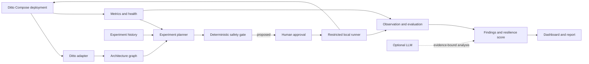

# Ditto AI Chaos Engineering

An AI-assisted resilience workbench for a deliberately isolated Eclipse Ditto deployment. The initial implementation has four coordinated specialists for deployment discovery, graph mapping, telemetry, and deterministic experiment planning, plus a loopback FastAPI and dashboard. It refuses to fabricate a Ditto topology when no manifest exists. Fault execution is deliberately disabled until Docker-backed approval, rollback, and recovery checks are implemented and verified.

## Why Ditto

Eclipse Ditto is an IoT digital-twin framework with five cooperating microservices and a locally runnable Docker Compose deployment. Its industrial IoT domain is relevant to Bosch, while its service boundaries and built-in metrics make it a useful resilience target. We keep Ditto upstream code in an ignored external checkout; this repository does not fork or patch it.

## Architecture



See [the architecture](docs/architecture.md) and [the full blueprint](docs/project-blueprint.md).
The upstream Ditto module paths and the custom workbench code map are in [Ditto codebase map](docs/ditto-codebase-map.md); the role-based 5-person breakdown and shared setup checklist are in [team implementation plan](docs/team-implementation-plan.md).

## Current Status

- Verified upstream target: [eclipse-ditto/ditto](https://github.com/eclipse-ditto/ditto), release `3.9.8` as checked on 2026-10-10.
- Local Ditto startup, benchmark dependencies, health/metrics endpoints, license, and architectural boundaries are documented in [Ditto integration](docs/ditto-integration.md).
- JSON Schemas and examples define shared data contracts in [schemas](schemas/); Compose and Kubernetes discovery, Prometheus normalization, local SQLite baseline history, deterministic ranking, FastAPI routes, and the local dashboard are implemented.
- **M0 (Ditto runtime) verified 2026-10-10** on Docker Desktop (Windows 11, 7.6 GiB for Docker). The stack runs with the image pins from `deploy/image-pins.env`, all 5 Ditto services report healthy, and the API answers on `127.0.0.1:8080`. `simulator/smoke_test.py` passes 5/5, which confirms on the live stack:
  - the Ditto v2 API paths (`/api/2/policies`, `/api/2/things`, `/api/2/search/things`)
  - the policy body with the `nginx:ditto` subject
  - the `mongo:7.0.14` tag
- The Docker chaos runner is implemented as an opt-in local process with fixed Compose actions, approval, cleanup, recovery, kill-switch, and audit gates. The execute endpoint returns `503` unless `CHAOS_EXECUTION_ENABLED=true` is explicitly set on the operator machine.
- Team repository: https://github.com/adicodegiter/ditto-debugger

## Prerequisites

- Windows 10/11 with PowerShell 7 recommended, Git, Docker Desktop with Docker Compose v2, and at least 2 CPU cores and 4 GB RAM available to Docker for the upstream single-instance Ditto setup.
- Python 3.12+ for repository checks.
- Node.js 18+ only if using Ditto's official Artillery load tool. Its documented benchmark setup also lists Kafka (with topic deletion enabled) and MMock; confirm the selected scenarios and required services during preflight.

## Local Setup

### Run the target: Eclipse Ditto 3.9.8 (`deploy/ditto/`)

`deploy/ditto/` is a self-contained copy of upstream `deployment/docker` at tag `3.9.8`,
adapted as follows (see the header of `docker-compose.yml`):

- **Pinned image tags.** [`deploy/image-pins.env`](deploy/image-pins.env) is the single source of
  truth: Ditto `3.9.8`, `mongo:7.0.14` and `nginx:1.27.2-alpine`. Nothing uses `latest`. The
  compose fallbacks repeat the same values, and `tests/test_deploy.py` checks that they match.
- **Loopback-only ports.** Every published port binds to `127.0.0.1`: 8080 (API via nginx),
  8081 (gateway direct) and 27017 (MongoDB). Upstream binds to `0.0.0.0`.
- **Named MongoDB volume.** Data lives in the `ditto_mongodb_data` volume, so it survives a
  normal reset.
- **Vendored assets.** nginx's static assets (images, WoT models) are copied into `deploy/ditto/assets/`, so
  no upstream checkout is needed at runtime.

Docker Desktop needs at least 6 GB of memory, and host port 8080 must be free.

Run from the repository root (Git Bash or WSL2 on Windows):

```bash
docker compose --env-file deploy/image-pins.env -f deploy/ditto/docker-compose.yml pull
docker compose --env-file deploy/image-pins.env -f deploy/ditto/docker-compose.yml up -d
bash deploy/health_check.sh --wait 300   # per-container health + API check, exit 0 = healthy
python simulator/smoke_test.py           # policy -> thing -> update -> read back -> search
```

| Command | What it does |
|---|---|
| `bash deploy/health_check.sh [--wait N]` | Container state/health + `/health` + authenticated search |
| `bash deploy/reset.sh` | `compose down`, pull the pinned images, `up -d`, then wait for healthy. **Keeps** MongoDB data |
| `bash deploy/reset.sh --wipe-data` | Also deletes the MongoDB volume (asks for confirmation) |
| `python simulator/smoke_test.py` | 5-step end-to-end API check, exit 0 = all PASS (`--help` for options) |

For the bounded fleet workload and baseline metrics used by the Workload & Measurement role, run:

```bash
python simulator/fleet_workload.py --duration-seconds 30 --metrics-dir data/metrics
python -m monitor.cli --metrics-dir data/metrics
```

The workload records JSON Lines in `data/metrics/*.jsonl` for the write, search, and freshness SLIs; the monitor CLI summarizes success rate, latency percentiles, and freshness windows without inventing missing data.
The control plane reads these live client-side samples for its last 30-second observation window, so Prometheus is optional for experiment detection. Missing any required SLI fails closed. During an approved experiment it samples every two seconds, restores the target, polls `/health` and a functional canary for up to 60 seconds, and stores deterministic findings at `/api/v1/findings`.

- API: `http://127.0.0.1:8080/api/2/` (sample basic auth `ditto:ditto`, loopback only)
- Ditto UI: `http://127.0.0.1:8080/ui/`
- No Swagger UI. Upstream's `swagger-ui` service and `/apidoc` route were removed because they aren't needed. For
  API reference, see https://www.eclipse.dev/ditto/http-api-doc.html.

Gotchas:
- **Use `127.0.0.1`, not `localhost`.** On Windows, `localhost` tries IPv6 `::1` first and
  adds about 2 s to every new connection, which corrupts the latency SLIs.
- **Restart the file-mounting containers after a branch switch.** If `git checkout` touches
  files in `deploy/ditto/`, nginx returns `500` (`pread() ... nginx.htpasswd failed`).
  Docker Desktop keeps the old file mount, so restart those containers:
  `docker compose --env-file deploy/image-pins.env -f deploy/ditto/docker-compose.yml restart nginx`.
- **Optional upstream source.** You can clone the source for reference into the ignored
  `vendor/` folder:
  `git clone --branch 3.9.8 --depth 1 https://github.com/eclipse-ditto/ditto vendor/ditto`.

Validate this repository's contracts:

```powershell
py -3.12 -m venv .venv
.\.venv\Scripts\Activate.ps1
python -m pip install -r requirements-dev.txt
python -m unittest discover -s tests -v
```

Run the workbench locally on loopback (the target and Prometheus can remain unavailable; discovery will report that honestly):

```powershell
python -m pip install -r requirements-dev.txt
python -m uvicorn app.main:app --app-dir backend --host 127.0.0.1 --port 8000
```

Open `http://127.0.0.1:8000`. Discovery reads `deploy/ditto/docker-compose.yml` by default (override with `DITTO_COMPOSE_FILE`). Set `PROMETHEUS_URL` to a loopback Prometheus instance once one is configured. Never bind this workbench to `0.0.0.0`.

See [deployment instructions](docs/deployment.md) for version and telemetry caveats.

## Demo Workflow (Planned)

1. Start the pinned local Ditto stack and a low, bounded workload.
2. Capture a healthy baseline and build a confidence-labelled graph from the checked-out Compose file and official architecture facts.
3. Ask the planner for a candidate; show its target, hypothesis, graph evidence, predicted impact, uncertainty, and risk.
4. Require a named human approval. Execute only the allow-listed short container restart in the local Compose project.
5. Verify `/alive` and a functional Ditto canary, compare telemetry with the baseline, and produce an evidence-linked finding and score.

The planned flow is detailed in [the demo runbook](docs/hackathon-demo.md). Until the runner exists, do not interpret the configuration examples as executable fault injection.

## Team Workflow

Start with [CONTRIBUTING.md](CONTRIBUTING.md), use the issue forms under `.github/ISSUE_TEMPLATE/`, and make pull requests using `.github/pull_request_template.md`. Work is divided by module ownership and acceptance criteria in [the project blueprint](docs/project-blueprint.md). Do not commit `.env` files, credentials, private logs, Ditto data, or the external upstream checkout.

## License and Authorization

Original project files use the MIT License; Eclipse Ditto remains separately licensed under EPL-2.0. Confirm Bosch hackathon and employer IP/publication rules before public release. Use this tool only on systems you own or are explicitly authorized to test. See [SECURITY.md](SECURITY.md).