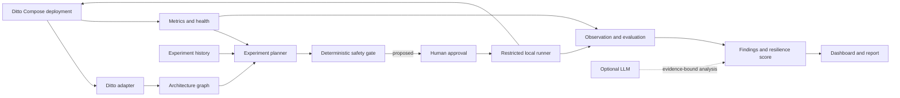

# Ditto AI Chaos Engineering

An AI-assisted resilience workbench for a deliberately isolated Eclipse Ditto deployment. The initial implementation has four coordinated specialists for deployment discovery, graph mapping, telemetry, and deterministic experiment planning, plus a loopback FastAPI and dashboard. It refuses to fabricate a Ditto topology when no manifest exists. Fault execution is deliberately disabled until Docker-backed approval, rollback, and recovery checks are implemented and verified.

## Why Ditto

Eclipse Ditto is an IoT digital-twin framework with five cooperating microservices and a locally runnable Docker Compose deployment. Its industrial IoT domain is relevant to Bosch, while its service boundaries and built-in metrics make it a useful resilience target. We keep Ditto upstream code in an ignored external checkout; this repository does not fork or patch it.

## Architecture



See [the architecture](docs/architecture.md) and [the full blueprint](docs/project-blueprint.md).
The upstream Ditto module paths and the custom workbench code map are in [Ditto codebase map](docs/ditto-codebase-map.md); the role-based 5-person breakdown and shared setup checklist are in [team implementation plan](docs/team-implementation-plan.md).

## Current Status

- Verified upstream target: [eclipse-ditto/ditto](https://github.com/eclipse-ditto/ditto), release `3.9.8` as checked on 2026-10-10.
- Local Ditto startup, benchmark dependencies, health/metrics endpoints, license, and architectural boundaries are documented in [Ditto integration](docs/ditto-integration.md).
- JSON Schemas and examples define shared data contracts in [schemas](schemas/); Compose and Kubernetes discovery, Prometheus normalization, local SQLite baseline history, deterministic ranking, FastAPI routes, and the local dashboard are implemented.
- **M0 (Ditto runtime) verified 2026-10-10** on Docker Desktop (Windows 11, 7.6 GiB for Docker). The stack runs with the image pins from `deploy/image-pins.env`, all 5 Ditto services report healthy, and the API answers on `127.0.0.1:8080`. `simulator/smoke_test.py` passes 5/5, which confirms on the live stack:
  - the Ditto v2 API paths (`/api/2/policies`, `/api/2/things`, `/api/2/search/things`)
  - the policy body with the `nginx:ditto` subject
  - the `mongo:7.0.14` tag
- **Chaos runner.** It runs only as a separate operator process (`python -m safety.cli execute <experiment_id>`). The API never runs Docker, and its execute endpoint always returns `503`. The runner:
  - requires `CHAOS_EXECUTION_ENABLED=true`
  - polls the kill switch every 2 s during a fault, using real SLI samples from `data/metrics/*.jsonl`
  - arms an independent watchdog process before injecting a fault
  - verifies recovery after every run, including aborted runs

  `--dry-run` reads real state and SLIs but changes no container. See [docs/safety-model.md](docs/safety-model.md).
- **M1 dependency map:** [docs/dependency-map.md](docs/dependency-map.md) (Mermaid) and `ai/dependency_map.json`, generated from the pinned compose file by `python -m ai.dependency_map`. Every edge is labelled configured, documented or manual, and every Ditto node lists the SLIs it can affect.
- **M4 done on 2026-10-10:** a real `things-search` restart completed, with recovery verified 4.2 s after rollback. A forced kill-switch test aborted 2.5 s into the fault and rolled back 0.5 s later. See [docs/m4-results.md](docs/m4-results.md); to repeat it, follow [docs/m4-runbook.md](docs/m4-runbook.md).
- **Day 2 (M5, M6) in progress:** three fault types (restart, pause, traffic burst; plus a bounded MongoDB CPU throttle), predicted vs observed analysis, ranked findings, resilience score and the deliverables. Tasks, owners and the critical path are in [docs/day2-plan.md](docs/day2-plan.md).
- Team repository: https://github.com/adicodegiter/ditto-debugger

## Prerequisites

- Windows 10/11 with PowerShell 7 recommended, Git, Docker Desktop with Docker Compose v2, and at least 2 CPU cores and 4 GB RAM available to Docker for the upstream single-instance Ditto setup.
- Python 3.12+ for repository checks.
- Node.js 18+ only if using Ditto's official Artillery load tool. Its documented benchmark setup also lists Kafka (with topic deletion enabled) and MMock; confirm the selected scenarios and required services during preflight.

## Local Setup

### Run the target: Eclipse Ditto 3.9.8 (`deploy/ditto/`)

`deploy/ditto/` is a self-contained copy of upstream `deployment/docker` at tag `3.9.8`,
adapted as follows (see the header of `docker-compose.yml`):

- **Pinned image tags.** [`deploy/image-pins.env`](deploy/image-pins.env) is the single source of
  truth: Ditto `3.9.8`, `mongo:7.0.14` and `nginx:1.27.2-alpine`. Nothing uses `latest`. The
  compose fallbacks repeat the same values, and `tests/test_deploy.py` checks that they match.
- **Loopback-only ports.** Every published port binds to `127.0.0.1`: 8080 (API via nginx),
  8081 (gateway direct) and 27017 (MongoDB). Upstream binds to `0.0.0.0`.
- **Named MongoDB volume.** Data lives in the `ditto_mongodb_data` volume, so it survives a
  normal reset.
- **Vendored assets.** nginx's static assets (images, WoT models) are copied into `deploy/ditto/assets/`, so
  no upstream checkout is needed at runtime.

Docker Desktop needs at least 6 GB of memory, and host port 8080 must be free.

Run from the repository root (Git Bash or WSL2 on Windows):

```bash
docker compose --env-file deploy/image-pins.env -f deploy/ditto/docker-compose.yml pull
docker compose --env-file deploy/image-pins.env -f deploy/ditto/docker-compose.yml up -d
bash deploy/health_check.sh --wait 300   # per-container health + API check, exit 0 = healthy
python simulator/smoke_test.py           # policy -> thing -> update -> read back -> search
```

| Command | What it does |
|---|---|
| `bash deploy/health_check.sh [--wait N]` | Container state/health + `/health` + authenticated search |
| `bash deploy/reset.sh` | `compose down`, pull the pinned images, `up -d`, then wait for healthy. **Keeps** MongoDB data |
| `bash deploy/reset.sh --wipe-data` | Also deletes the MongoDB volume (asks for confirmation) |
| `python simulator/smoke_test.py` | 5-step end-to-end API check, exit 0 = all PASS (`--help` for options) |

For the bounded fleet workload and baseline metrics used by the Workload & Measurement role, run:

```bash
python simulator/fleet_workload.py --duration-seconds 120 --metrics-dir data/metrics
python -m monitor.cli --metrics-dir data/metrics
```

The workload records JSON Lines in `data/metrics/*.jsonl`:
- **Concurrent probes:** write, search and freshness each run in their own thread with their own HTTP session, so a hung probe can't stall the others. Timeouts are 5 s for writes and 3 s for search and freshness reads, so a down service shows up as fast failures.
- **Freshness via SSE (default):** each telemetry change is timed when it arrives on Ditto's SSE stream (`received_at − last_seen`). `--freshness-method poll-proxy` falls back to reading values back, and those records are labelled as such.
- **Extra files:** a local Docker resource snapshot goes to `container.jsonl`, and a per-run summary to `data/baselines/`.

**Baselines** (`python -m safety.cli baseline` or `POST /api/v1/baselines`) are built from the **most recent live workload run only**, using at most its last 5 minutes. A baseline is refused, with the reason, if:
- the run has less than **120 s** of samples
- the run stopped writing more than 60 s ago
- any SLI is unhealthy or missing

The control plane reads the same live samples for its 30 s kill-switch window, so Prometheus is optional.

- API: `http://127.0.0.1:8080/api/2/` (sample basic auth `ditto:ditto`, loopback only)
- Ditto UI: `http://127.0.0.1:8080/ui/`
- No Swagger UI. Upstream's `swagger-ui` service and `/apidoc` route were removed because they aren't needed. For
  API reference, see https://www.eclipse.dev/ditto/http-api-doc.html.

Gotchas:
- **Use `127.0.0.1`, not `localhost`.** On Windows, `localhost` tries IPv6 `::1` first and
  adds about 2 s to every new connection, which corrupts the latency SLIs.
- **Restart the file-mounting containers after a branch switch.** If `git checkout` touches
  files in `deploy/ditto/`, nginx returns `500` (`pread() ... nginx.htpasswd failed`).
  Docker Desktop keeps the old file mount, so restart those containers:
  `docker compose --env-file deploy/image-pins.env -f deploy/ditto/docker-compose.yml restart nginx`.
- **Optional upstream source.** You can clone the source for reference into the ignored
  `vendor/` folder:
  `git clone --branch 3.9.8 --depth 1 https://github.com/eclipse-ditto/ditto vendor/ditto`.

Validate this repository's contracts:

```powershell
py -3.12 -m venv .venv
.\.venv\Scripts\Activate.ps1
python -m pip install -r requirements-dev.txt
python -m unittest discover -s tests -v
```

Run the workbench locally on loopback (the target and Prometheus can remain unavailable; discovery will report that honestly):

```powershell
python -m pip install -r requirements-dev.txt
python -m uvicorn app.main:app --app-dir backend --host 127.0.0.1 --port 8000
```

Open `http://127.0.0.1:8000`. Discovery reads `deploy/ditto/docker-compose.yml` by default (override with `DITTO_COMPOSE_FILE`). Set `PROMETHEUS_URL` to a loopback Prometheus instance once one is configured. Never bind this workbench to `0.0.0.0`.

See [deployment instructions](docs/deployment.md) for version and telemetry caveats.

## Dashboard

```bash
python -m uvicorn app.main:app --app-dir backend --host 127.0.0.1 --port 8000
```

Open http://127.0.0.1:8000. Start the workload (`python simulator/fleet_workload.py --duration-seconds 900`) to see live values.

| View | Shows |
|---|---|
| **Overview** | Live SLIs for the last 30 s (write success and p95, search success, SSE freshness p95) with 5-minute sparklines, refreshed every 5 s; latest baseline; latest run; agent status |
| **Architecture** | Dependency map (`ai/dependency_map.json`): Ditto services from compose plus the workbench components. Configured, documented and manual edges are drawn differently, with SLI tags and the SLI request paths |
| **Experiments** | Capture a baseline (refusals show the reason, e.g. under 120 s); stale baselines are flagged; plan; approve or reject proposals by typing `APPROVE`/`REJECT` with your name and a reason. Approved proposals show copy-ready operator commands |
| **Runs** | Each run's timeline (inject → kill switch → rollback → recovered), kill-switch charts poll by poll against their limits, recovery check, findings, and dry-run/forced-test labels |
| **Safety** | Policy limits and allow-list, abort thresholds, watchdog log, audit trail |

The dashboard never executes a fault. Experiments run only from the operator CLI (`python -m safety.cli`), as described in [docs/m4-runbook.md](docs/m4-runbook.md). The read-only data endpoints behind the views are `/api/v1/slis`, `/api/v1/slis/series`, `/api/v1/baselines`, `/api/v1/policy`, `/api/v1/dependency-map` and `/api/v1/watchdog`.

## Demo Workflow

1. **Start the target and the workload.** Bring up the pinned Ditto stack (see Local Setup), then run the bounded fleet workload. Keep it running in its own terminal for the whole demo:
   ```bash
   python simulator/fleet_workload.py --duration-seconds 900 --metrics-dir data/metrics
   ```
2. **Capture a baseline.** With the API running (`python -m uvicorn app.main:app --app-dir backend --host 127.0.0.1 --port 8000`), call `POST /api/v1/discovery/refresh`, then `POST /api/v1/baselines`. The baseline is built from the live SLI samples in `data/metrics/` and is refused unless every SLI is healthy.
3. **Plan and approve.** Call `POST /api/v1/experiments/plan` for ranked candidates (target, hypothesis, graph evidence, predicted impact, risk). Then a human records a decision with `POST /api/v1/experiments/{id}/approval`, using the candidate hash.
4. **Rehearse, then execute from the operator process.** The API never executes; its `/execute` endpoint returns 503.
   ```bash
   python -m safety.cli execute <experiment_id> --dry-run
   CHAOS_EXECUTION_ENABLED=true python -m safety.cli execute <experiment_id>
   ```
   - The dry run changes no container and does not use up the approval.
   - Before a real run, the runner checks steady state and arms the independent watchdog. During the fault it polls the kill switch every 2 s and rolls back on the first breach.
5. **Recovery and findings.** After rollback, the runner checks `/health`, an authenticated canary, and the SLIs since rollback. It saves the run together with deterministic, evidence-linked findings (`GET /api/v1/runs`, `GET /api/v1/findings`).

More detail is in [the demo runbook](docs/hackathon-demo.md) and [the safety model](docs/safety-model.md).

## Day 2: three experiments, findings and score

Run each fault type once on the live stack (restart is already recorded in [docs/m4-results.md](docs/m4-results.md)). For every run:

1. `bash deploy/health_check.sh` (exit 0) and keep the workload running in its own terminal:
   `python simulator/fleet_workload.py --duration-seconds 1200 --metrics-dir data/metrics`.
2. Fresh baseline: `python -m safety.cli baseline` (refused with a reason if under 120 s or any SLI is unhealthy).
3. Plan: `python -m safety.cli plan <baseline_id>`. Each candidate shows its action (`restart_container`, `pause_container`, `cpu_throttle`, `traffic_burst`), target, hypothesis and per-SLI prediction.
4. Approve (a human types it): `python -m safety.cli approve <experiment_id> --by "<name>" --reason "<why>"`.
5. Rehearse, then execute:
   ```bash
   python -m safety.cli execute <experiment_id> --dry-run
   CHAOS_EXECUTION_ENABLED=true python -m safety.cli execute <experiment_id>
   ```
6. The run record lands in `data/experiments/` with recovery verified or an abort reason. Diagnosis compares predicted and observed SLIs; findings and the resilience score are built only from these records.

The findings report will be in `docs/findings-report.md` and the one-page architecture in `docs/architecture.md` (both Day 2 deliverables). Forced kill-switch tests (`--forced-test`) are labelled and never scored.

## Team Workflow

Start with [CONTRIBUTING.md](CONTRIBUTING.md), use the issue forms under `.github/ISSUE_TEMPLATE/`, and make pull requests using `.github/pull_request_template.md`. Work is divided by module ownership and acceptance criteria in [the project blueprint](docs/project-blueprint.md). Do not commit `.env` files, credentials, private logs, Ditto data, or the external upstream checkout.

## License and Authorization

Original project files use the MIT License; Eclipse Ditto remains separately licensed under EPL-2.0. Confirm Bosch hackathon and employer IP/publication rules before public release. Use this tool only on systems you own or are explicitly authorized to test. See [SECURITY.md](SECURITY.md).