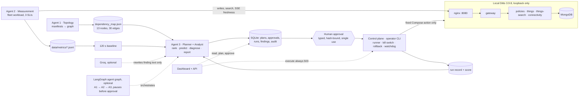

# Ditto Resilience Workbench: architecture on one page

**What it is.** A local, evidence-driven chaos-engineering loop for a connected-vehicle digital-twin backend (Eclipse Ditto 3.9.8, Docker Compose, MongoDB). It maps the stack from its manifests, measures healthy behaviour under a simulated fleet, proposes bounded failure experiments, runs a human-approved one through a deterministic control plane with a kill switch, and reports ranked, evidence-linked findings with a resilience score.

## Components and boundaries

| Part | Does | Must not |
|---|---|---|
| **Agent 1** Topology & Evidence | Reads the pinned Compose file, builds a versioned graph; every edge is labelled configured, documented or manual | Invent a service or edge with no source |
| **Agent 2** Workload & Measurement | Bounded fleet workload; SLIs: **write** (success, p50/p95), **search** (success, latency), **freshness** (SSE, staleness); JSON Lines samples; baseline needs ≥120 s and all SLIs healthy | Call a baseline healthy when samples are missing |
| **Agent 3** Planner & Analyst | Ranks allowlisted experiments, predicts per-SLI impact, diagnoses predicted vs observed, ranks findings, computes the score | Execute anything |
| **Control plane** (deterministic code, not an agent) | Revalidates policy, approval, baseline age and steady state; runs one fixed action; polls the kill switch; rolls back; verifies recovery | Run anything outside `configs/experiment-policy.yaml` |

## One experiment, end to end
1. **Baseline** from live samples (max age 60 min) → 2. **Plan**: candidates with hypothesis, risk and `predicted_slis` (hold / degrade / fail) → 3. **Human approves** by typing it at an interactive terminal; the approval is bound to the candidate hash and expires in 10 min → 4. **Dry run** prints the exact Compose commands, changes nothing → 5. **Execute** with `CHAOS_EXECUTION_ENABLED=true`: an independent **watchdog is armed first**, then the fault runs for at most 60 s → 6. **Recovery check**: `/health` plus an authenticated search canary plus SLIs back within baseline (timeout 180 s) → 7. **Record, diagnose, score, rank**.

**Fault catalog (fixed commands):** restart (10 s), stop (45 s), pause (30 s), CPU throttle (45 s), traffic burst via nginx (45 s). Targets: `gateway`, `things-search`; MongoDB is denied except for the CPU throttle.

## Safety controls
- **Agents never execute.** Only the operator CLI runs faults; the API's `execute` returns **503 by design**; the dashboard, planner and LLM hold no Docker capability.
- **Kill switch**, polled every 2 s over the last 30 s, aborts and rolls back on: write error rate **> 20%**, write p95 **> 3× baseline**, freshness p95 **> 30 s**, missing samples (treated as unhealthy), another service not healthy, or `max_duration_seconds` exceeded. Limits come only from the policy file.
- **Local only**: loopback ports, local Compose project; images pinned (no `latest`); secrets only from env / git-ignored `.env`.
- **Forced kill-switch tests and dry runs are labelled and never scored.**

## How the AI decides
- **Agent graph** (`backend/app/graph.py`, LangGraph 1.2.12 if installed, else the same nodes in sequence): `discover` (Agent 1) → `measure` (Agent 2) → `plan` (Agent 3) → pause before `approval`. Gate edges send a missing, stale, low-coverage (< 80%) or graph-mismatched baseline back to `measure` once to capture a fresh one (the first pass reuses the latest stored baseline) or end with the reason; no graph ends the run. The graph ends at approval and never executes: approved plans run only via `python -m safety.cli execute`. A second graph does post-run `diagnose` → predicted vs observed → findings. Read-only view: `GET /api/v1/agent-graph`.
- **Planner** (`weighted_heuristic_v1`, deterministic): graph impact (dependents), a novelty term `1/(1+trials)` and an uncertainty term `1/√(1+trials)` from the SQLite outcome history, capped by per-target risk (first experiment ≤ 0.35).
- **Diagnosis**: per SLI, predicted vs observed (`match`, `worse`, `better`) and a prediction-accuracy figure; real run records are read directly.
- **Findings**: ranked by severity then confidence. **Measured facts** (each with its source in the run record) are kept apart from the **hypothesis/fix**, with a validation re-run. A real kill-switch abort is a high-severity finding.
- **Resilience score** = 0.30 availability + 0.20 latency + 0.20 recovery + 0.15 containment + 0.15 detection, from the run's own observations (inputs stored in `score_inputs`). Missing inputs are left out, never guessed; below 0.80 coverage the score is `incomplete`.
- **LLM (optional, `AI_PROVIDER=groq`)**: rewrites finding summary and recommendation only. Ids, severity, evidence and confidence stay deterministic; output is schema-checked; any error or missing key falls back to the deterministic text.

## Evidence so far
Restart, pause and burst ran live with fresh baselines, dry runs and typed approvals, and every one recovered. The 5.7 remediation re-run (client search timeout 10 s → 3 s) cut a failing search from 10 s to 3 s; the gateway still holds requests while `things-search` is down, so a server-side timeout or circuit breaker stays open. A Mac run of the burst was aborted by the kill switch at 455 ms against a 302 ms limit and recovered in 4.4 s. Records: `docs/m5-results.md`, `docs/evidence/`.

## Limits
Single-node local stack; few runs per fault, so results are exploratory, not statistics; the LLM only rewrites text, and all numbers and decisions come from deterministic code.
