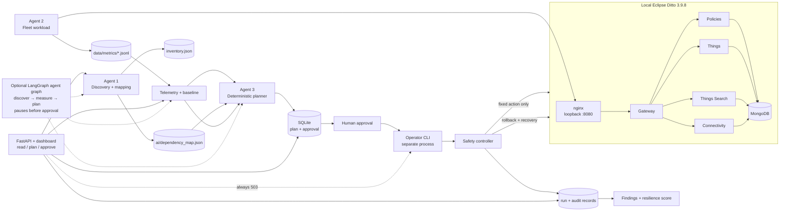
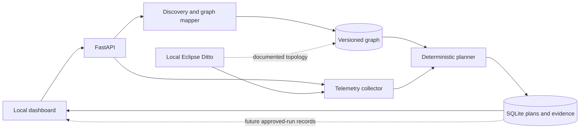

# Ditto Resilience Workbench

The workbench is a local, evidence-driven control loop for testing the resilience of an Eclipse Ditto connected-vehicle backend. It does not model vehicle physics or direct vehicle-to-vehicle communication: the simulator writes synthetic vehicle telemetry to Ditto, and the workbench measures the backend's behavior when a bounded dependency fault is introduced.

## Three Agents and One Control Plane

| Part | Responsibility | Boundary |
| --- | --- | --- |
| Agent 1: topology and evidence | Reads the pinned Compose/Kubernetes manifests, exports the inventory, and builds a versioned dependency graph. | Never executes Compose or invents runtime edges. |
| Agent 2: workload and measurement | Sends synthetic vehicle updates, probes writes/search/freshness, and saves JSON Lines observations and healthy baselines. | Never calls a baseline healthy when required samples are missing. |
| Agent 3: planner and analyst | Ranks allowlisted candidates from graph impact, novelty, uncertainty, telemetry, baseline, and history; generates evidence-linked findings. | Recommends only; never executes Docker or changes policy. |
| Deterministic control plane | Revalidates policy, approval, baseline, target, action, duration, telemetry, rollback, recovery, and audit state. | Only the separate operator process may run fixed local Docker actions. |
| Agent graph (optional orchestration) | Chains the three agents as a LangGraph state graph (`backend/app/graph.py`) with gate edges and an interrupt before human approval; a second graph runs post-run diagnose → predicted vs observed → findings. | Ends at approval; imports nothing that executes (tested). Without LangGraph the same nodes run in sequence. |

## Evidence Flow

1. `tools/export_topology.py` reads `deploy/ditto/docker-compose.yml` without starting services. It writes the schema-compatible inventory to `data/inventory.json` and the versioned graph to `ai/dependency_map.json`. Each edge retains configured, documented, runtime-observed, or manual provenance; the current static export makes no runtime claims.
2. The fleet workload sends synthetic Thing updates through nginx and Ditto Gateway. Measurement records write success/error rate, p50/p95 latency, search behavior, and freshness in `data/metrics/*.jsonl`.
3. A baseline is valid only when the graph matches, telemetry is fresh, and required metric coverage is present. The planner then creates an immutable candidate with target, fixed action, duration, risk, hypothesis, predicted impact, and evidence references.
4. The API records a typed human approval but cannot execute a fault. `POST /api/v1/experiments/{id}/execute` remains `503`; execution is initiated only by `python -m safety.cli execute <id>` on the operator machine.
5. The safety controller checks the local Compose project, allowlist, single-use approval, baseline age, steady state, and concurrency. During a fault it polls the live SLI window, aborts on policy thresholds, rolls back, and verifies recovery through health, an authenticated canary, and post-rollback SLIs.
6. Run, audit, recovery, and finding records are persisted for comparison of predicted versus observed impact. Missing evidence suppresses a resilience score rather than becoming an assumed success.

## Safety Gates

- **Local-only:** Ditto URL, Compose project, published ports, and recovery checks are loopback-bound.
- **Fixed actions:** only policy-enabled, hard-coded Compose actions on `gateway` or `things-search` are eligible; MongoDB is denied.
- **Human approval:** approval is hash-bound to the immutable candidate, expires after the policy interval, and is single-use.
- **Abort limits:** write error rate, write p95 multiplier against baseline, freshness p95, missing samples, unrelated service health, and maximum duration.
- **Recovery:** rollback is attempted in cleanup; an independent watchdog is armed before injection; recovery requires both functional API health and SLIs within threshold.
- **Process boundary:** the API, dashboard, planner, and optional model never receive Docker execution capability.

## How the AI Decides

The planner is deterministic rather than an autonomous model. It filters candidates through the policy, then ranks eligible target/action pairs with `weighted_heuristic_v1` (0.40 graph impact + 0.35 novelty + 0.25 uncertainty, from the run history). Every recommendation carries a hypothesis, per-SLI predictions (`hold` / `degrade` / `fail`), risk, and evidence references. After a run, diagnosis compares predicted with observed per SLI, and the findings and resilience score come from the run record. The optional Groq adapter (`AI_PROVIDER=groq`) only rewords finding text; it cannot alter safety decisions or execute actions.

The agents can be orchestrated as a LangGraph graph: `discover` (Agent 1) → `measure` (Agent 2) → `plan` (Agent 3) → pause before `approval`. Conditional edges are the planning gates: no graph ends the run; a missing, stale, under-80%-coverage or graph-mismatched baseline goes back to `measure` (bounded retries) or ends with the reason. The graph never runs a fault; the approved plan is executed only by the operator CLI.

## What the Dashboard Shows

The local dashboard reads the versioned API for topology, agent state, live SLIs, baselines, the agent graph, proposals, approvals, run history (timeline, kill-switch charts, recovery, findings), audit evidence, and policy. It is an inspection and approval surface; it does not claim that a fault occurred when the target or telemetry is unavailable, and it cannot execute.

## Current Scope

Five fixed fault actions are enabled in the policy, each with its own rollback: `restart_container` (10 s), `stop_container` (45 s) and `pause_container` (30 s) on `gateway` or `things-search`; `cpu_throttle` (45 s, the only action allowed on `mongodb`); and `traffic_burst` (45 s, a bounded extra workload through nginx on separate twins). Restart, pause and burst have run live with recovery verified (`docs/m5-results.md`); combined failures (two staged faults, one kill switch) and a re-run after a server-side fix are documented as stretch goals. Network delay and disk fill are not implemented. The Ditto stack and all experiment data remain local and synthetic.
# Architecture Overview

The workbench reads local Compose/Kubernetes manifests, configured loopback telemetry, and documented Ditto architecture. The graph keeps configured, documented, runtime-observed, and manual provenance distinct; unobserved paths are never presented as runtime calls. Each graph snapshot is versioned and includes impacted-component paths and the SLI tags associated with each node.

The canonical M1 export is generated with `python tools/export_topology.py`. It writes the schema-compatible inventory to `data/inventory.json` and the current evidence-backed graph to `ai/dependency_map.json`; the command refuses partial discovery or policy targets absent from the pinned manifest. It resolves image tags and ports from `deploy/image-pins.env`, and adds the workbench's own components and calls as `manual` nodes and edges. `python -m ai.dependency_map` runs the same export and renders the Mermaid page [docs/dependency-map.md](dependency-map.md); `--check` fails if either file is out of date.

## How The AI Decides

The current planner is deterministic. It first requires a fresh healthy baseline that matches the graph plus current telemetry with at least 80% coverage. Eligible candidates are ranked by graph impact, novelty, and uncertainty using `weighted_heuristic_v1`; policy risk and duration limits reject candidates before they are shown. Each proposal carries a hypothesis and references to its graph, baseline, and metrics. No LLM call is needed to rank a plan.

## Safety Boundary

The API and planner are local read/plan services and do not receive Docker access or arbitrary command execution. Approval is a human, hash-checked record tied to the exact proposal; it does not start a fault. The execute endpoint remains hard-disabled until the separate allowlisted runner, rollback, kill switch, and recovery checks pass their safety gate. Missing telemetry or graph evidence blocks planning instead of being treated as healthy.

## Demo Narrative

“We map Ditto from evidence, predict which SLIs a bounded fault could affect, compare that prediction with recorded outcomes, and keep human approval separate from execution.”