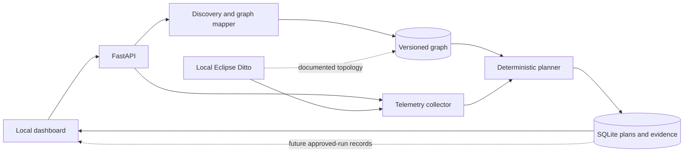

# Architecture Overview

The workbench reads local Compose/Kubernetes manifests, configured loopback telemetry, and documented Ditto architecture. The graph keeps configured, documented, runtime-observed, and manual provenance distinct; unobserved paths are never presented as runtime calls. Each graph snapshot is versioned and includes impacted-component paths and the SLI tags associated with each node.

## How The AI Decides

The current planner is deterministic. It first requires a fresh healthy baseline that matches the graph plus current telemetry with at least 80% coverage. Eligible candidates are ranked by graph impact, novelty, and uncertainty using `weighted_heuristic_v1`; policy risk and duration limits reject candidates before they are shown. Each proposal carries a hypothesis and references to its graph, baseline, and metrics. No LLM call is needed to rank a plan.

## Safety Boundary

The API and planner are local read/plan services and do not receive Docker access or arbitrary command execution. Approval is a human, hash-checked record tied to the exact proposal; it does not start a fault. The execute endpoint remains hard-disabled until the separate allowlisted runner, rollback, kill switch, and recovery checks pass their safety gate. Missing telemetry or graph evidence blocks planning instead of being treated as healthy.

## Demo Narrative

“We map Ditto from evidence, predict which SLIs a bounded fault could affect, compare that prediction with recorded outcomes, and keep human approval separate from execution.”