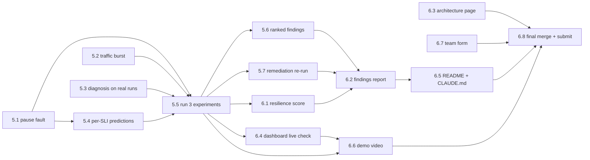

# Day 2 plan (M5 + M6)

Source: team status doc "Ditto Resilience Workbench: Status and Day 2 Plan" (2026-10-10).
Tick items here as they land; P1 keeps this file and the status table in `CLAUDE.md` in sync.

Day 1 (M0–M4) is complete: one real `things-search` restart recovered 4.2 s after rollback,
and a forced kill-switch test aborted 2.5 s into a 10 s fault (`docs/m4-results.md`).
Day 2 adds two more fault types, real predicted-vs-observed analysis, a resilience score,
and the five deliverables.

## Critical path



Start 5.1, 5.2 and 5.3 in parallel. 5.5 (the three live runs) gates findings, score, report
and video. 6.3 (architecture page) and 6.7 (team form) have no dependencies and can start now.

## M5: experiments and analysis (Day 2 morning)

| # | Task | Owner | Helps | Needs | Done when | Status |
|---|---|---|---|---|---|---|
| 5.1 | `pause_container` (compose pause/unpause) as a fixed action: policy entry, rollback, kill-switch path, tests for forbidden targets and over-limit durations | P5 | P3 | – | Tests pass; dry run prints the exact commands | Done: merged in #12 (`pause_container`, plus `cpu_throttle`); tests in `tests/test_fault_catalog.py` |
| 5.2 | Bounded traffic burst (`--burst-rate`, `--burst-seconds`, hard cap, auto-stop), callable as a control-plane action | P3 | P5 | – | Burst stops by itself at its cap; samples still land in JSONL | Done: `traffic_burst` merged in #12; separate burst twins (`vehicle-101`+) in #14 |
| 5.3 | Rebase and merge PR #5; diagnosis reads real run records (`write_error_rate`, `recovery_verified`, `recovery_time_seconds`) | P4 | P1 merges | – | Diagnosis of the M4 run record matches its numbers | Done: merged in #12; M4 run gives write p95 19.6 ms, 0% write errors, recovery 4.188 s (matches `docs/m4-results.md`) |
| 5.4 | Planner per-SLI predictions (`predicted_slis`: hold / degrade / fail) per fault type; schema field added | P4 | P2 (schema review) | 5.1 | Each candidate shows predictions; schema tests pass | Done: merged in #12 |
| 5.5 | Run the three experiments live: restart (done), pause, burst. Each: fresh baseline, dry run, typed approval, execute | P5 runs | P3 watches SLIs; P1 keeps stack up; a human approves | 5.1–5.4 | Three run records in `data/experiments/`, each with recovery verified or an abort reason | Done 2026-10-10: restart (M4), pause `run-370897363c60`, burst `run-4083aa7e13a1`; see `docs/m5-results.md` |
| 5.6 | Ranked findings from the three runs; measured facts separate from hypotheses; each with a fix and a validation test | P4 | P3 (numbers) | 5.5 | Ordered by severity; every claim linked to a run | Done: `ai/ranking.py` merged in #16 (`python -m ai.ranking --markdown --run-file ...`); records in `docs/evidence/windows-host/` (#21) |
| 5.7 | Remediation re-run: keep the 3 s search timeout (PR #8), re-run the `things-search` restart, compare before/after | P3 | P4 records, P5 runs | 5.5 | Before/after numbers for the search hang in the report | Done 2026-10-10: `run-a09cb1bcbb7c`; failing search 10.0 s → 3.0 s; see `docs/m5-results.md` |

## M6: score, deliverables, submission (Day 2 afternoon)

| # | Task | Owner | Helps | Needs | Done when | Status |
|---|---|---|---|---|---|---|
| 6.1 | Resilience score: fill `score_components` (availability, latency, recovery, containment, detection) from real measurements in the runner | P5 | P4 | 5.5 | Each non-forced run has a complete score with its inputs shown | Done: score derived from real measurements (#15) with its raw inputs in `score_inputs` (#19) |
| 6.2 | Findings report `docs/findings-report.md`: ranked weaknesses, measured evidence, fixes, re-test result, score | P4 | P3, P5 | 5.6, 5.7, 6.1 | Every number traces to a run record | In PR #23: generated by `python -m ai.report_export` from `docs/evidence/windows-host/`; three named weaknesses with fixes; overall score 83.69 |
| 6.3 | One-page architecture overview: rewrite `docs/architecture.md` (three agents, control plane, safety gates, how the AI decides) | P2 | P4 | – | Fits one page; diagram matches the code | Rewritten on `main` (agents, control plane, safety gates); check it fits one page |
| 6.4 | Check the dashboard (PR #11) on the live stack: topology, proposals, approvals, runs, SLIs, findings | P2 | P3 | 5.5 | Every view shows real data; nothing hardcoded | Done: all five views checked on the live stack (API and rendered pages), 4 defects fixed; see [dashboard-check.md](dashboard-check.md). Live SLI panel needs the workload running |
| 6.5 | README Day 2 run steps; refresh `CLAUDE.md` status | P1 | everyone sends one line | 6.2 | A newcomer can follow it end to end | Done: README status, Day 2 newcomer walkthrough and `CLAUDE.md` status refreshed (P1). Add the report and video links when they land |
| 6.6 | Demo video, 3 min or less: fault injected, SLIs drop, kill switch or rollback, findings | P3 | P5 runs the fault, P2 dashboard | 5.5, 6.4 | Uploaded; link in README | **Pending (P3).** Not recorded yet |
| 6.7 | Team form: members, tools, AI models, libraries, data | P1 | all check their part | – | Submitted | Draft updated in `docs/team-form.md` (roles from git history, Groq). Each person confirms their row; P1 submits |
| 6.8 | Final merge, full test run, submit 30 min early | P1 | all | all | Tests green on `main`; submission confirmed | Checklist below. Last code merge left: #17 (green on top of `main` with the ranking fix in the P1 wrap-up PR) |

## Who does what

- **P1 (deploy, discovery, integration, merges):** keep the stack healthy during runs
  (`bash deploy/health_check.sh` before each run); merge PR #5 and the fault-type PRs
  (5.1, 5.2) once tests pass; README Day 2 steps and `CLAUDE.md` status (6.5); team form
  (6.7); final merge, full test run, submit 30 min early (6.8).
- **P2 (graph, schemas, API, dashboard, architecture):** review the `predicted_slis` schema
  change (5.4); rewrite the architecture page (6.3); check every dashboard view live (6.4);
  dashboard shots for the video (6.6).
- **P3 (workload, measurement, baseline, video):** traffic burst (5.2); fresh baseline and
  SLI watch during each experiment (5.5); remediation re-run (5.7); measured numbers to P4
  (5.6); demo video (6.6).
- **P4 (planner, diagnosis, findings):** PR #5 wired to real run records (5.3); per-SLI
  predictions (5.4); ranked findings with fixes and validation tests (5.6); findings report (6.2).
- **P5 (control plane, safety, score):** `pause_container` with rollback and tests (5.1);
  burst as a control-plane action with limits (with P3); run the three experiments (5.5);
  resilience score (6.1); run the fault for the video (6.6).

## Deliverables

| # | Deliverable | Status | Missing | Owner |
|---|---|---|---|---|
| 1 | Public repo + README (setup and run) | Ready | Report and video links once they exist | P1 |
| 2 | Demo video, 3 min or less | Not started | Record on the Windows host: fault injected, SLIs drop, rollback, findings | P3 |
| 3 | One-page architecture overview | Rewritten | Check it fits one page and matches the code | P2 |
| 4 | Findings report | In PR #23 | Review and merge | P4 |
| 5 | Team form | Draft ready (`docs/team-form.md`) | Members confirm their row, then P1 submits | P1 |

## 6.8 Final checklist (P1)

Do these in order, and submit at least 30 minutes before the deadline.

1. **Merge the last PRs:** #17 (P4) after its findings contract doc moves off `docs/findings-report.md`;
   then the findings report (6.2). Merge `main` into each branch first.
2. **Full test run on `main`:** `python -m unittest discover -s tests` must be all OK.
3. **Stack check:** `bash deploy/health_check.sh` (OVERALL: HEALTHY) and `python simulator/smoke_test.py` (5/5).
4. **Deliverables present:** README, `docs/architecture.md` (one page), `docs/findings-report.md`,
   the video link in the README, `docs/team-form.md` with every row confirmed.
5. **No secrets:** no `.env`, keys or `data/` files committed (`git status` clean; CI `secret-scan` green).
6. **Repo is public**, and the README's setup steps work from a fresh clone.
7. **Submit** the team form and the repo link; keep the confirmation.

## Rules that do not bend

- **Local only.** Only our own Ditto containers on the Windows host. Do not publish the
  dashboard anywhere (no Streamlit Community Cloud).
- **Agents never execute.** Only `safety.cli` runs faults, with `CHAOS_EXECUTION_ENABLED=true`
  and a typed human approval. API `execute` stays 503.
- **Every new fault type** ships with a fixed command, an allowlisted target, a max duration,
  abort thresholds, a rollback, a recovery check, and tests for forbidden targets and
  over-limit durations.
- **MongoDB stays out of routine fault injection** (only the bounded `cpu_throttle` lists it).
- **Missing samples are unhealthy.** No baseline, no experiment.
- **No invented numbers.** Every figure in the report, video and slides traces to
  `data/experiments/` or `data/metrics/*.jsonl`. Forced kill-switch tests are labelled and
  never scored.
- **Dry run first, every time.** Ask before destructive commands (volume deletion,
  `docker system prune`, `--wipe-data`).

## Commands (repo root, Git Bash or WSL)

```bash
# 1. Stack (P1)
docker compose --env-file deploy/image-pins.env -f deploy/ditto/docker-compose.yml up -d
bash deploy/health_check.sh --wait 300   # exit 0 = healthy
python simulator/smoke_test.py           # 5/5 PASS

# 2. Workload and SLIs (P3), own terminal
python simulator/fleet_workload.py --duration-seconds 1200 --metrics-dir data/metrics
python -m monitor.cli --metrics-dir data/metrics

# 3. Topology (P1, P2)
python -m ai.dependency_map

# 4. Experiment (P5 runs, a human approves), once per fault type
python -m safety.cli baseline
python -m safety.cli plan <baseline_id>
python -m safety.cli approve <experiment_id> --by "<name>" --reason "<why>"
python -m safety.cli execute <experiment_id> --dry-run
CHAOS_EXECUTION_ENABLED=true python -m safety.cli execute <experiment_id>

# 5. Dashboard (P2)
python -m uvicorn app.main:app --app-dir backend --host 127.0.0.1 --port 8000

# 6. Tests (everyone, before every PR)
python -m unittest discover -s tests
```
