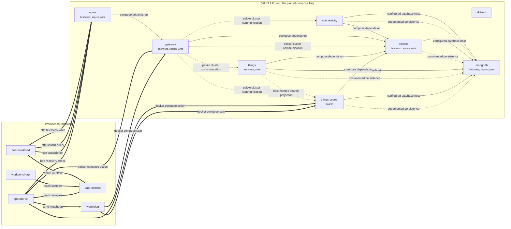

# Dependency Map

Generated by `python -m ai.dependency_map` from [`ai/dependency_map.json`](../ai/dependency_map.json). That file is written by
`tools/export_topology.py` from the pinned compose file and `deploy/image-pins.env`. Do not edit either file by hand.

**Edges:** 9 configured, 9 documented, 12 manual. In the diagram, solid lines are **configured** (compose), dotted lines are **documented** (Ditto architecture), and thick lines are **manual** (workbench components). No edge is claimed as runtime-observed.

## Which SLI depends on which service

| SLI | Request path |
|---|---|
| write | nginx → gateway → policies → things → mongodb |
| search | nginx → gateway → policies → things-search → mongodb |
| freshness | nginx → gateway → policies → things → mongodb |

## Ditto services

`Workbench SLIs` are the three CLAUDE.md SLIs (from the request paths above). `Affected metric families` come from the mapping agent.

| Service | Kind | Image | Published ports | Workbench SLIs | Affected metric families |
|---|---|---|---|---|---|
| `connectivity` | ditto_service | `docker.io/eclipse/ditto-connectivity:3.9.8` | — | — | service_availability, error_rate, p95_latency |
| `ditto-ui` | ditto_service | `docker.io/eclipse/ditto-ui:3.9.8` | — | — | service_availability |
| `gateway` | ditto_service | `docker.io/eclipse/ditto-gateway:3.9.8` | 127.0.0.1:8081→8080 | freshness, search, write | service_availability, error_rate, p95_latency |
| `mongodb` | database | `docker.io/mongo:7.0.14` | 127.0.0.1:27017→27017 | freshness, search, write | service_availability |
| `nginx` | proxy | `docker.io/nginx:1.27.2-alpine` | 127.0.0.1:8080→80 | freshness, search, write | service_availability |
| `policies` | ditto_service | `docker.io/eclipse/ditto-policies:3.9.8` | — | freshness, search, write | service_availability, error_rate |
| `things` | ditto_service | `docker.io/eclipse/ditto-things:3.9.8` | — | freshness, write | service_availability, error_rate, staleness_p95 |
| `things-search` | ditto_service | `docker.io/eclipse/ditto-things-search:3.9.8` | — | search | service_availability, error_rate, p95_latency, staleness_p95 |

## Workbench components (manual)

| Component | Module | Purpose |
|---|---|---|
| `fleet-workload` | `simulator/fleet_workload.py` | writes vehicle telemetry; probes write, search and freshness (SSE) SLIs |
| `workbench-api` | `backend/app` | discovery, mapping, baseline, planning, approval records; never executes faults |
| `operator-cli` | `safety/cli.py` | runner: steady-state check, live kill switch, rollback, recovery check |
| `watchdog` | `safety/watchdog.py` | independent max-duration cleanup, even if the runner dies |
| `data-metrics` | `data/metrics/*.jsonl` | SLI samples (JSON Lines) read by baseline and kill switch |
