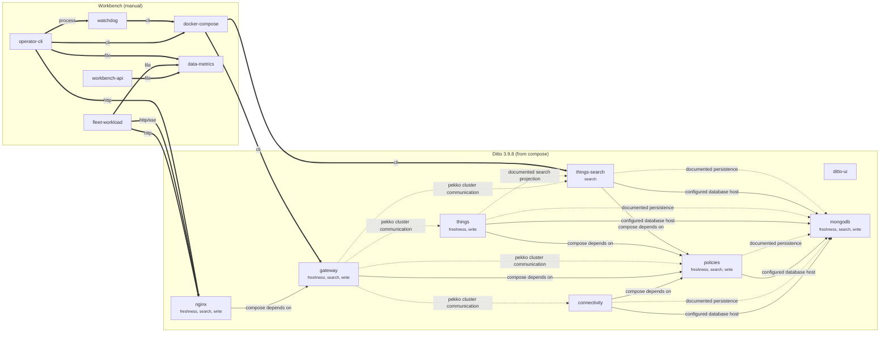

# Dependency Map

Generated by `python -m ai.dependency_map` from the pinned compose file and image pins. Do not edit by hand.
Machine-readable version: [`ai/dependency_map.json`](../ai/dependency_map.json).

Edge styles: solid = **configured** (compose), dotted = **documented** (Ditto architecture), thick = **manual** (workbench components).

## Which SLI depends on which service

| SLI | Request path | Measured by |
|---|---|---|
| write | nginx → gateway → policies → things → mongodb | simulator/fleet_workload.py (PUT /api/2/things/{id}/features/telemetry/properties) |
| search | nginx → gateway → policies → things-search → mongodb | simulator/fleet_workload.py (GET /api/2/search/things) |
| freshness | nginx → gateway → policies → things → mongodb | simulator/fleet_workload.py (telemetry timestamp read back; SSE when enabled) |

## Nodes

| Node | Kind | SLIs it can affect | Provenance |
|---|---|---|---|
| `connectivity` | ditto_service | — | configured |
| `ditto-ui` | ditto_service | — | configured |
| `gateway` | ditto_service | freshness, search, write | configured |
| `mongodb` | database | freshness, search, write | configured |
| `nginx` | proxy | freshness, search, write | configured |
| `policies` | ditto_service | freshness, search, write | configured |
| `things` | ditto_service | freshness, write | configured |
| `things-search` | ditto_service | search | configured |
| `fleet-workload` | workbench | — | manual |
| `workbench-api` | workbench | — | manual |
| `operator-cli` | control_plane | — | manual |
| `watchdog` | control_plane | — | manual |
| `docker-compose` | platform | — | manual |
| `data-metrics` | storage | — | manual |

- Ditto edges are static (configured from compose or documented by Ditto); none is runtime-observed yet.
- Docker network membership alone is not treated as an application call.
- manual = workbench components and calls written by this team, not discovered from a manifest.
