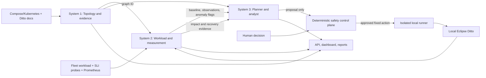

# Three-System Architecture and Five-Person Implementation Plan

This plan follows [`CLAUDE.md`](../CLAUDE.md), which is the source of truth for architecture, thresholds and milestones. If the two disagree, update this file to match CLAUDE.md.

Assign people by role during the team meeting; names are intentionally omitted. **Each person owns an individual setup/preflight task as well as their module**, so nobody is blocked waiting for one person to configure the whole repo.

## Common Setup, Done by Everyone

Each teammate completes this checklist before parallel coding:

1. Clone the team repository and create a branch using the naming rules in `CONTRIBUTING.md`.
2. Install Git, Python 3.11+ and Docker Desktop with Compose v2, and verify the versions listed in the README. On Windows, run shell scripts from Git Bash or WSL2. Node.js is needed only if you work on dashboard tooling.
3. Create and activate a local Python virtual environment, install `requirements-dev.txt`, and run `python -m unittest discover -s tests -v`.
4. Start the pinned target from the repository root, then check it:
   - `docker compose --env-file deploy/image-pins.env -f deploy/ditto/docker-compose.yml up -d`
   - `bash deploy/health_check.sh --wait 300`
   - `python simulator/smoke_test.py`

   The upstream Ditto source is optional reference material (clone it into the ignored `vendor/`) and is never edited. Never share `.env`, sample credentials, private logs, customer data or ignored checkouts.
5. Read `docs/ditto-codebase-map.md`, `docs/safety-model.md`, the shared schemas and the API contract. Confirm loopback-only endpoints (`DITTO_BASE_URL=http://127.0.0.1:8080`) and the dedicated synthetic namespace `bosch.fleet`.
6. Run the workbench API locally as described in the README and report any unavailable dependencies. Never run experiments against a remote or shared deployment.

## Three-System Architecture

Build a coordinated, evidence-grounded assistant, not an autonomous fault injector. Three end-to-end systems own the reasoning flow. APIs, schemas, storage and the dashboard are shared interfaces, not separate AI systems.

| System | What it owns | Inputs and outputs | Build order and acceptance |
| --- | --- | --- | --- |
| 1. Topology and evidence | Read-only deployment discovery and graph semantics | Pinned Compose/Kubernetes manifests and verified Ditto architecture → versioned inventory and graph with confidence, provenance (documented/configured/runtime-observed/manual), SLI tags, impact paths and criticality caveats; exported to `ai/dependency_map.json` | **First.** Preserve source evidence. Never treat `depends_on`, selectors or shared networks as runtime calls. Missing deployments produce no fabricated nodes, and partial evidence stays explicit. P2's graph, contracts and API integration is implemented and already reads `deploy/ditto/docker-compose.yml`. |
| 2. Workload and measurement | Fleet workload, the three SLIs, baselines, coverage and anomaly/threshold flags | Graph ID + fleet workload + SLI probe samples (`data/metrics/*.jsonl`) + optional Prometheus → normalized time-windowed observations, baseline, coverage, anomaly flags, impact and recovery measurements | **After M0.** Implement the error-rate, p95-latency and staleness detectors using the thresholds below. If a required signal is missing or stale, the result is `unknown`: block planning and abort any active run. Never report healthy in that case. Prove threshold and lost-signal behavior before any live fault. |
| 3. Planner and analyst | Deterministic candidate ranking, prediction, then predicted-vs-observed diagnosis and the findings report | Graph + fresh baseline + observations + policy/history → ranked proposals with predicted impact, a one-line reason and evidence references. After a run: impact and recovery evidence → predicted-vs-observed record, evidence-linked findings, severity ranking, fixes, resilience-score inputs | Ranking after Systems 1–2; diagnosis after the safety gate. The current planner is a reproducible heuristic, not a learned model. Everything must work with `AI_PROVIDER=none`. An optional LLM may only explain validated hypotheses, and its output is schema-checked. Missing evidence yields an inconclusive or failed status and no score, never an inferred success. |

Current state:
- **System 1:** foundations are in place, plus P2's contracts, API and dashboard integration.
- **System 3:** the heuristic planner exists.
- **System 2:** the telemetry collector checks Prometheus `up`, request-count and JVM metric families. The SLI detectors and the fleet workload are still in progress.
- **Approval:** P2's approval endpoint records a hash-bound human decision. That record is not a safety-controller sign-off.
- **Fault execution** stays hard-disabled (`execute` returns 503) until System 2 detection and P5's control plane are implemented and proven.

All three systems exchange versioned schema records through the orchestrator, never free-form agent-to-agent prompts. Each result includes status, provenance/evidence IDs, confidence or coverage where applicable, and explicit unavailable or insufficient-evidence states. Never send secrets, raw customer data or unrestricted logs to a model. Any model input is bounded and redacted, and the model has no tools, no policy-write access, no approval authority and no runner access.

### SLIs and abort thresholds

These are the starting values from CLAUDE.md. Tune them after the baseline exists, and change them in CLAUDE.md first.

| SLI / signal | Measured as | Abort when (last 30 s window) |
| --- | --- | --- |
| Write path | success rate and p50/p95 latency of telemetry writes | error rate > 20%, or p95 > 3× baseline p95 |
| Search path | success rate and latency of fleet search queries | (reported; no abort threshold yet) |
| Freshness | staleness = now − telemetry timestamp (SSE live stream; poll-based proxy until then, labelled as such) | p95 staleness > 30 s |
| Missing samples | any required SLI with no fresh samples | always: treated as unhealthy, never as healthy |
| Any experiment | wall-clock time since injection | exceeds `max_duration_s` (independent watchdog) |

**Recovery time** is the time from rollback until all SLIs are back within baseline.

### Deterministic control plane (not an AI system)

The safety controller, human approval and fixed-action runner live in `chaos/` and `configs/experiment-policy.yaml`. Together they reject:
- stale or mismatched baselines
- disallowed targets or actions
- excess risk, duration or concurrency
- unhealthy preconditions
- expired approvals
- failed recovery

If telemetry is lost or a detector cannot establish health, the control plane aborts, runs bounded cleanup, marks the result inconclusive or failed, and suppresses scoring. An independent watchdog enforces the maximum fault duration even if the API or Prometheus stops responding. If cleanup or recovery checks fail, experiments stop and an operator must recover the system. No model output can change these decisions.

## Workstreams

| Person | Module ownership | Individual setup task | Deliverable and acceptance |
| --- | --- | --- | --- |
| P1. Ditto deploy + discovery + integration | `deploy/` (compose, `image-pins.env`, health check, reset), `backend/app/agents/discovery.py`, `backend/app/settings.py`, deploy and discovery tests; merges at checkpoints | Done for M0. Pinned stack healthy, smoke test passes, and `tests/test_deploy.py` enforces pins and loopback ports. Keep these green. | System 1 input owner. Parse manifests without executing them and produce a validated service inventory with provenance and warnings, resolving `${VAR:-default}` image tags and ports. Runtime discoveries carry runtime evidence. Sanitized fixtures cover missing and malformed inputs. |
| P2. Graph + API/contracts + UI | `backend/app/agents/mapping.py`, `schemas/`, `backend/app/main.py`, `backend/app/store.py`, `backend/app/orchestrator.py`, `frontend/`, `docs/architecture.md` | Run the API locally, inspect `/openapi.json`, validate contracts, and map upstream service names to module paths | System 1 graph and contracts, plus shared API/UI integration across all three systems. Versioned graph and contracts, provenance and impact paths, `ai/dependency_map.json` export, saved proposal/approval state, and dashboard graph/history/findings views are in scope. Approval stays record-only and execution stays disabled. Partial evidence and empty result states must be visible. |
| P3. Workload + measurement | `simulator/` (bootstrap, fleet workload), `monitor/` (write, search and freshness probes; SLI math), `backend/app/agents/telemetry.py`, `configs/telemetry.yaml`, telemetry tests; demo video | Bootstrap the fleet against the live stack, confirm samples land in `data/metrics/*.jsonl`, and inspect Ditto's `/alive` and metrics output | System 2 owner. Bounded fleet workload; the three SLIs; a baseline of at least 120 s (10 min preferred) with full coverage; SSE freshness replacing the poll proxy; error-rate, p95 and staleness detectors plus missing-signal behavior, proven before M4. Prometheus is an addition, not a prerequisite for the baseline. |
| P4. Planner + analyst | `backend/app/agents/planning.py`, `ai/` (diagnosis, findings report), focused tests | Run the planner with a fixture graph and history; set `AI_PROVIDER=none` and verify no model key is needed | System 3 owner. Keep ranking deterministic, with a reason per candidate. Add predicted-vs-observed diagnosis with evidence-linked, severity-ranked findings and fixes. An optional LLM explains validated hypotheses only. Test unsupported-evidence rejection and the deterministic fallback. |
| P5. Control plane + evaluation | `chaos/` (runner, kill switch, rollback, recovery check), `configs/experiment-policy.yaml`, resilience score, end-to-end tests | Verify the Docker context and project name (`ditto`), the target allow-list, loopback bindings, and the baseline and recovery canary. Exercise dry-run approval first. | Own the deterministic control plane: immutable human approval, fixed target/action mapping, isolated local runner, kill switch wired to System 2's thresholds, rollback, cleanup and recovery checks. Prove forbidden targets and actions are rejected (M3) before lifting the 503. Connect run outcomes to System 3 and the audit records. |

## Shared Integration Agreements

- **Schema changes:** the contract owner (P2) publishes a schema or OpenAPI change before any other workstream changes exchanged fields. Additive optional fields are preferred. Breaking changes need a version bump and a migration note.
- **Facts vs edges:** discovery owns factual resource records; the graph owns edge semantics. Compose `depends_on`, Kubernetes selectors, docs and runtime traces carry different provenance values. Docker network membership alone does not prove an application call.
- **Telemetry outputs:** System 2 owns normalized observations, coverage and threshold/anomaly flags. The planner consumes observations and graph IDs, never raw logs. Missing or stale required signals block planning and abort an active run, and are never read as success. Analysis produces evidence references, never execution payloads.
- **Runner isolation:** the runner has its own process boundary. The API, planner and LLM get no Docker socket and no command capability. `POST .../execute` stays disabled until policy enforcement, human approval, rollback and recovery tests pass.
- **Reviews:** integrate continuously through pull requests and CI. Nobody merges a schema, safety or integration-boundary change without a reviewer from outside that change. Avoid direct pushes to `main`.

## Milestones and Dependencies

Milestones and timing follow CLAUDE.md. The brief's Day-1 minimum is **M4**.

| Milestone | When | Depends on | Exit criteria |
| --- | --- | --- | --- |
| M0. Setup + target preflight | Day 1 morning | None | **Done 2026-10-10.** Pinned Ditto 3.9.8 healthy on the Windows host. API paths, `nginx:ditto` policy subject and Mongo tag verified by the smoke test. All tests green. |
| M1. Real inventory and graph | Day 1 midday | M0 | Graph derived from the actual pinned manifest. Every edge has provenance and impact direction. Node SLI tags and impact paths present. `ai/dependency_map.json` exported. No fabricated nodes or runtime claims. |
| M2. Workload + healthy baseline | Day 1 afternoon | M1 | Fleet workload running. Baseline of at least 120 s with all three SLIs covered. SSE freshness replaces the poll proxy. Graph version and workload metadata saved. Missing or stale signals fail the baseline. |
| M3. Planner + safety gate | Day 1 late afternoon | M1, M2 | Reproducible ranking. Kill switch wired to the runner in dry-run. Rollback implemented. Forbidden targets and actions rejected in tests. Approval bound to an immutable plan with expiry. Then lift the 503. |
| M4. One recovery-tested fault | **Day 1 evening** | M3 | Human-approved `things-search` restart/stop with rollback and max duration. Threshold-triggered and lost-telemetry aborts, the independent watchdog, automatic cleanup and recovery evidence all work. A **forced abort proves the kill switch**. Failed detection or recovery counts as inconclusive or failed, never healthy. |
| M5. More faults + diagnosis | Day 2 morning | M4 | **3+ fault types** from the CLAUDE.md catalog. Predicted vs observed for each. Ranked, evidence-linked findings with fixes. Deterministic explanation works without an LLM. |
| M6. Score, report, demo, submission | Day 2 afternoon | M1–M5 | Resilience score; findings report; README demo; 1-page architecture overview; demo video (3 min or less); team form; submit 30 min early. Live and fixture data clearly labelled; results exportable. |

**Fallback:** if Ditto is not healthy *with the workload running* by 13:00 on Day 1, switch the target to OWASP crAPI. Only the deployment, workload and service names change.

**Do not run M4 before M0–M3 are proven.** The runner and the System 2 detectors are not built yet. Telemetry baselines come from the SLI probes; Prometheus is optional, and adding it is tracked separately.
